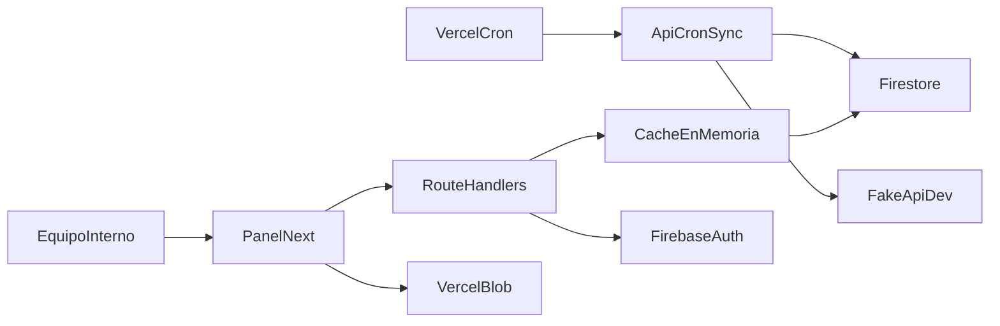
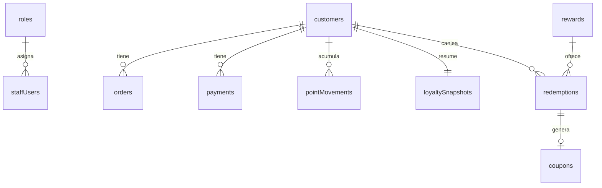

# Programa de lealtad

Panel interno, sincronización diaria y API de evaluación de un programa de lealtad. El cliente entra por `/login`. El equipo opera en `/panel`: resumen, clientes, riesgo, cumpleaños, catálogo, canjes, equipo, roles, tokens y sincronización. La corrida trae usuarios, pedidos y pagos de la tienda, calcula puntos, nivel, gasto de 12 meses y riesgo, y deja el historial en Firestore.

La app ya resuelve el flujo de operación. La capa de datos es el punto que conviene cambiar para que crezca: hoy Firestore cobra y limita por documento leído, y el volumen de clientes, pedidos, pagos y movimientos ya es considerable. El dominio (reglas de puntos, permisos y contratos HTTP) está separado del almacén, así que esa sustitución no reescribe el producto.

El portal del cliente (`/portal`) sigue como pantalla de reserva. El resto del sistema está conectado.

## Tecnología

| Pieza | Uso |
| --- | --- |
| **Next.js 16** (App Router), **React 19**, **TypeScript** | Panel, login y route handlers en el mismo proyecto. |
| **Tailwind CSS 4** | Estilos. En desarrollo, Turbopack procesa el CSS con `@tailwindcss/turbopack`. |
| **Firebase Auth** | Sesión del equipo. El navegador solo recibe `NEXT_PUBLIC_FIREBASE_*`. |
| **Firebase Admin SDK** | Corre en el servidor. Verifica el token, lee y escribe Firestore y salta las reglas del cliente. |
| **Firestore** (plan Spark) | Clientes, pedidos, pagos, puntos, roles, tokens y corridas. |
| **Vercel** | Publicación, cron diario y **Vercel Blob** para la foto de una recompensa. Firestore guarda la URL. |
| **fakeapi.dev** | Fuente de la tienda. La key vive en `FAKEAPI_KEY` y no entra al bundle del navegador. |

La hora de negocio es la de México, UTC−6 fijo. La fecha de corte de las reglas es `2026-04-30` (`src/domain/cutoff.ts`). Las reglas de puntos viven en `src/domain/loyalty-rules.ts` y los permisos válidos en `src/domain/permissions.ts`.



La caché es un parche de proceso. La flecha estable del sistema es la de los route handlers hacia un almacén que pueda filtrar y agregar sin leer cada registro.

## Parches para convivir con el límite de lecturas

En el plan Spark, Firestore permite del orden de **50.000 lecturas de documento al día**. Cada documento que devuelve una consulta cuenta como una lectura, aunque solo se pidan unos campos. Al cruzar el tope, el API responde `RESOURCE_EXHAUSTED` (`Quota exceeded`) y el panel entero falla, incluida la comprobación de `staffUsers` al entrar a cualquier sección.

Con muchos clientes, pedidos, pagos y movimientos, una sincronización y unas cuantas pantallas del panel consumen esa cuota. Estos parches bajan la presión. Siguen siendo medidas de contención: la cuota del día y el precio por lectura siguen ahí.

1. **Caché en memoria del servidor** (`src/lib/read-cache.ts`). Si dos peticiones piden la misma clave a la vez, comparten una sola lectura. El resultado se reutiliza unos segundos: perfil de equipo 45 s, clientes, snapshots, riesgo y cumpleaños 60 s, resumen 30 s, búsqueda 20 s, ficha 15 s. Se invalida al sincronizar y al cambiar equipo, roles, canjes o acceso. Vive en el `Map` de ese proceso de Node. En Vercel cada instancia tiene la suya, se pierde al reciclar el servidor y no se comparte. Si la cuota del día ya se agotó, un fallo de caché no puede leer Firestore.

2. **Consultas más chicas en el panel.** El resumen usa `count()` (Firestore lo cobra por bloques de índice, mucho más barato que bajar cada cliente). El listado vacío trae 30 clientes. El top lee 10 snapshots y después solo esos clientes, por id. La ficha y el detalle buscan un documento, no la colección.

3. **Sincronización contenida** (`src/lib/sync-run.ts`). La tienda se baja en páginas de 100. Un 429 o un 5xx espera y reintenta, con un tope, para no disparar ráfagas. Un candado (`syncLock`, 8 minutos) impide dos corridas a la vez: cada una releería clientes, pedidos, pagos y movimientos. El id del documento es el id de fakeapi.dev, así que repetir la corrida actualiza y no duplica puntos. Al releer pedidos, pagos y movimientos se piden solo los campos del recálculo (`select`). Eso achica el payload. Firestore igual cuenta una lectura por documento devuelto.

4. **Cumpleaños por ventana de año.** La regla es quien cumple entre el 30 de abril y el 7 de mayo de la fecha de corte. Firestore no resuelve “mes y día” de una fecha en una sola consulta indexada, así que el panel lanza un rango `YYYY-04-30` … `YYYY-05-07` por cada año de 1920 a 2026, en tandas. El resultado es correcto y la cantidad de lecturas crece con los años y con los registros que caen en cada rango.

5. **Ajustes de Next.js 16 para no leer de más ni romper el bundle.**
   - `cacheComponents` está activo. Las rutas dinámicas llaman `await connection()` (`next/server`) para ejecutarse en la petición y no durante el prerender, donde dispararían lecturas a Firestore en el build.
   - El build de producción es `next build --webpack`. El Admin SDK no cierra bien con el empaquetador por defecto de esta versión.
   - `overrides` fija `jwks-rsa` en **3.2.2**. `firebase-admin` pide la 4.x, que arrastra módulos que el bundle de Next no resuelve al verificar el ID token.
   - `server-only` marca el Admin SDK, la caché y la clave privada para que no entren al JavaScript del navegador. En Vercel, `FIREBASE_PRIVATE_KEY` va en una línea y el código restaura los `\n`.

Estos parches mantienen operable un volumen moderado dentro de la cuota gratuita durante un rato. Con el número de registros que ya maneja la tienda, el tope diario aparece como error 500 en el panel. Hacer la caché más larga, o ponerle Redis, seguiría pagando cada documento la primera vez que una instancia lo toca, y la sincronización seguiría recorriendo colecciones enteras.

## Base estructurada: el paso que escala

La recomendación es mover clientes, pedidos, pagos, movimientos, snapshots, canjes y corridas a una **base estructurada** (PostgreSQL u otro motor relacional con índices). Firebase Auth puede quedarse para las cuentas. El almacén de negocio es el que conviene sacar de Firestore.

En una base así, un conteo, un filtro de riesgo, el top de puntos, la búsqueda paginada y el cumpleaños por mes y día son una consulta. El motor usa el índice y devuelve las filas que hacen falta. El costo acompaña al almacenamiento y a la consulta, y deja de multiplicarse por cada clic del panel y por cada documento de la corrida diaria.

El código ya está partido para ese cambio:

- Las reglas de puntos, nivel, riesgo y fecha de corte no conocen Firestore.
- El panel y la API de evaluación hablan con funciones de servidor (`src/lib/panel-loyalty.ts`, `src/lib/sync-run.ts`, `src/lib/panel-admin.ts`, `src/lib/fidelizacion-read.ts`). Cambiar esas funciones de colección a tablas deja iguales las pantallas y los contratos `GET /api/fidelizacion/...`.
- Los ids de pedido, pago y movimiento ya son estables. Una carga inicial y las corridas siguientes encajan en `INSERT … ON CONFLICT`.
- Permisos, roles y el candado de sincronización son reglas de aplicación. Se trasladan igual a filas y a una transacción.

Ese es el camino de escala: mismo producto, un almacén que agrega y filtra. Los parches de caché y de consulta acotada pueden retirarse cuando las lecturas dejen de cobrarse una por una.

## Arquitectura de datos

El id de un pedido, un pago o un movimiento es el id de fakeapi.dev.



- `staffUsers`: equipo interno. El id del documento es el uid de Firebase Auth.
- `roles`: nombre y lista de permisos.
- `apiTokens`: tokens de evaluación. Solo se guarda el hash.
- `customers`: clientes de `/users`. Cuenta de portal aparte, estado inicial `sin acceso`.
- `orders` y `payments`: copia normalizada de la fuente.
- `pointMovements`: historial. El saldo no sustituye el movimiento.
- `loyaltySnapshots`: puntos, puntos disponibles, nivel, gasto de 12 meses, riesgo y días sin actividad.
- `rewards`, `redemptions`, `coupons`: catálogo, canjes y cupones.
- `syncRuns` y `syncLock`: resultado de cada corrida y candado para no solaparlas.

Esa forma ya es relacional. En Postgres serían tablas con clave foránea e índices sobre `customer_id`, `en_riesgo`, `puntos`, `nivel` y el mes-día de `dob`.

Las reglas en `firestore.rules` dejan que una persona autenticada lea su perfil de equipo o el de cliente ligado a su uid. El cliente no escribe lealtad ni lee pedidos, pagos, puntos, canjes ni tokens. Eso lo hace el Admin SDK.

## Cómo correrlo en local

Requisitos: Node.js 20 o superior.

```bash
npm install
```

Copia `.env.example` a `.env.local` y llena los valores. Luego:

```bash
npm run dev
```

Abre [http://localhost:3000](http://localhost:3000). La raíz redirige a `/login`. Con una cuenta de equipo se entra a `/panel`.

Comprueba el cableado:

```bash
curl http://localhost:3000/api/health
curl http://localhost:3000/api/cron/sync
curl -H "Authorization: Bearer tu-cron-secret" http://localhost:3000/api/cron/sync
curl -H "Authorization: Bearer token-de-evaluacion" http://localhost:3000/api/fidelizacion/clientes/241
```

`/api/health` lista los nombres de variables que faltan y no imprime sus valores. El cron responde 401 sin el secreto. Los endpoints de fidelización responden 401 sin un Bearer cuyo hash esté activo en `apiTokens`.

Si el panel responde 500 y el log dice `RESOURCE_EXHAUSTED` / `Quota exceeded`, el proyecto de Firebase agotó la cuota diaria de lecturas. Esperar el reinicio del día, o mover los datos a una base estructurada, es lo que vuelve a abrir el panel. Alargar la caché no recupera una cuota ya gastada.

## Variables de entorno

| Variable | Dónde |
| --- | --- |
| `NEXT_PUBLIC_FIREBASE_API_KEY` | Cliente |
| `NEXT_PUBLIC_FIREBASE_AUTH_DOMAIN` | Cliente |
| `NEXT_PUBLIC_FIREBASE_PROJECT_ID` | Cliente |
| `NEXT_PUBLIC_FIREBASE_STORAGE_BUCKET` | Cliente |
| `NEXT_PUBLIC_FIREBASE_MESSAGING_SENDER_ID` | Cliente |
| `NEXT_PUBLIC_FIREBASE_APP_ID` | Cliente |
| `FIREBASE_PROJECT_ID` | Servidor |
| `FIREBASE_CLIENT_EMAIL` | Servidor |
| `FIREBASE_PRIVATE_KEY` | Servidor |
| `CRON_SECRET` | Servidor |
| `FAKEAPI_KEY` | Servidor |
| `BLOB_READ_WRITE_TOKEN` | Servidor, al subir fotos |

Las mismas variables van en Vercel. No subas `.env.local` ni el JSON de la cuenta de servicio.

## Conectar Firebase

1. Crea un proyecto en el plan Spark.
2. En Authentication, activa el proveedor Correo/contraseña.
3. Registra una app web y copia su configuración a las variables `NEXT_PUBLIC_FIREBASE_*`.
4. En Configuración del proyecto, Cuentas de servicio, genera una clave privada. De ese JSON salen `FIREBASE_PROJECT_ID` (`project_id`), `FIREBASE_CLIENT_EMAIL` (`client_email`) y `FIREBASE_PRIVATE_KEY` (`private_key`).
5. Instala Firebase CLI, entra con `firebase login` y elige el proyecto con `firebase use --add`.
6. Publica las reglas: `firebase deploy --only firestore:rules`.

El plan Spark alcanza para desarrollar y para una demo corta. Con el volumen real de la sincronización, la cuota de lecturas se agota y el panel deja de responder. Para un uso continuo, el almacén de negocio debe ser una base estructurada. Auth puede seguir en Firebase.

## Conectar Vercel

1. Sube el repositorio a GitHub.
2. Importa el proyecto en Vercel. El framework es Next.js. El build del `package.json` ya usa Webpack.
3. Carga las variables de `.env.example` en el proyecto, plan Hobby.
4. `vercel.json` declara el cron diario a las 13:00 UTC (`/api/cron/sync`). Con `CRON_SECRET` definido, Vercel llama ese endpoint con `Authorization: Bearer <CRON_SECRET>`.

La key de [fakeapi.dev](https://fakeapi.dev/register) solo vive en `FAKEAPI_KEY`. El límite con key es de 1,000 requests por hora.

En Vercel la caché de lecturas no se comparte entre instancias. Cada arranque en frío vuelve a leer Firestore. Por eso el parche ayuda en local y en una sola instancia caliente, y se queda corto cuando el tráfico o la corrida diaria reparte el trabajo.

## Estructura

- `src/app/login`, `src/app/panel`: sesión y panel.
- `src/app/portal`: reserva del portal del cliente.
- `src/lib/firebase.ts`: Auth y Firestore del navegador.
- `src/lib/firebase-admin.ts`: Admin SDK, solo servidor.
- `src/lib/read-cache.ts`: caché de lecturas. Parche de cuota.
- `src/lib/sync-run.ts`: descarga, normalización, puntos y candado.
- `src/lib/panel-loyalty.ts`, `src/lib/panel-admin.ts`, `src/lib/fidelizacion-read.ts`: lecturas y escrituras del panel y de la API de evaluación.
- `src/domain/permissions.ts`: permisos fijos y roles iniciales (Administrador, Gerente, Atención a clientes).
- `src/domain/loyalty-rules.ts`, `src/domain/cutoff.ts`: reglas, independientes del almacén.
- `src/app/api/health`, `src/app/api/cron/sync`, `src/app/api/panel/*`, `src/app/api/fidelizacion/*`.
- `firestore.rules`, `firebase.json`, `vercel.json`.

## Por dónde puede crecer

El sistema es mejorable sin tirar lo que ya corre.

1. **Almacén.** Pasar las colecciones de negocio a una base estructurada e indexada. Ahí se retiran la caché en memoria, los conteos de emergencia y las ventanas de cumpleaños por año. Auth, el panel y los contratos HTTP se quedan.
2. **Portal del cliente.** Contraseña temporal de un solo uso, cambio obligatorio, catálogo y canje en una transacción. La pantalla de `/portal` es el hueco que falta. El catálogo y los canjes del equipo ya existen en el panel.
3. **Operación.** Más de una instancia de servidor, corridas más frecuentes y más historial de movimientos caben cuando la consulta deje de costar un documento por fila. El candado, la paginación de la tienda y los ids estables ya están pensados para repetirse.

Las credenciales de prueba y el token de evaluación se envían en el correo de entrega. No van en este repositorio.
