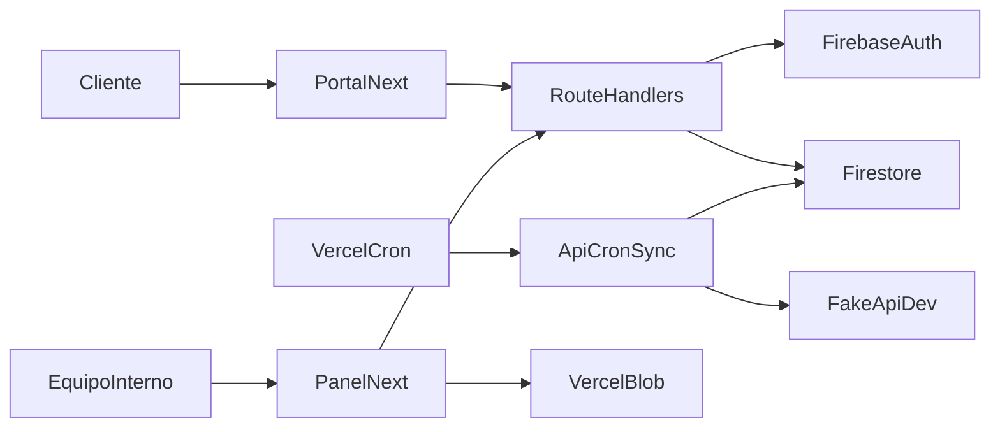
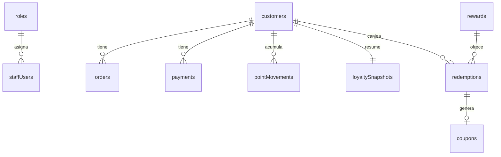

# Programa de lealtad

Base de un programa de lealtad para una tienda en línea. El panel interno y el portal del cliente viven en Next.js. Firebase guarda los datos y las cuentas. Vercel publica la app y dispara la sincronización diaria.

Esta entrega es la base de conexión. Todavía no calcula puntos ni exige inicio de sesión.

## Decisiones

- **Next.js (App Router) y Tailwind.** Vercel detecta el framework y publica panel, portal y `/api` en el mismo proyecto Hobby. No hace falta un export estático.
- **Firebase Auth y Firestore en el plan Spark.** El navegador solo recibe la configuración pública (`NEXT_PUBLIC_FIREBASE_*`). El Admin SDK corre en el servidor, salta las reglas de Firestore y es el único que escribirá puntos, pedidos, pagos, canjes y corridas.
- **Cron de Vercel**, una vez al día, hacia `GET /api/cron/sync`. Las funciones programadas de Firebase piden un plan de pago. `FAKEAPI_KEY` y `CRON_SECRET` no van al bundle del navegador.
- **Fotos en Vercel Blob.** Firestore guardará la URL, no el archivo.
- **Fecha de corte de las reglas: `2026-04-30`.** La hora de México es UTC−6 fijo, sin horario de verano. No se usa la fecha de hoy.

## Arquitectura



## Modelo de datos

Colecciones de Firestore. El id de un pedido o un pago es el id de fakeapi.dev, para que sincronizar dos veces no duplique puntos.



- `staffUsers`: equipo interno. El id del documento es el uid de Firebase Auth.
- `roles`: nombre y lista de permisos. Los permisos válidos están fijos en `src/domain/permissions.ts`.
- `apiTokens`: tokens de evaluación. Solo se guarda el hash.
- `customers`: clientes de `/users`. Cuenta de portal aparte, estado inicial `sin acceso`.
- `orders` y `payments`: copia normalizada de la fuente.
- `pointMovements`: historial. No basta con el saldo.
- `loyaltySnapshots`: puntos, puntos disponibles, nivel, gasto de 12 meses, riesgo y días sin actividad.
- `rewards`, `redemptions`, `coupons`: catálogo, canjes y cupones.
- `syncRuns`: inicio, fin, requests y resultado de cada corrida.

Las reglas en `firestore.rules` dejan que una persona autenticada lea su perfil de equipo o el de cliente ligado a su uid. El cliente no puede escribir lealtad ni leer pedidos, pagos, puntos, canjes ni tokens. Eso lo hará el Admin SDK.

## Cómo correrlo en local

Requisitos: Node.js 20 o superior.

```bash
npm install
```

Copia `.env.example` a `.env.local` y llena los valores. Luego:

```bash
npm run dev
```

Abre [http://localhost:3000](http://localhost:3000). La raíz entra a `/login`. `/panel` y `/portal` son pantallas vacías.

Comprueba el cableado:

```bash
curl http://localhost:3000/api/health
curl http://localhost:3000/api/cron/sync
curl -H "Authorization: Bearer tu-cron-secret" http://localhost:3000/api/cron/sync
curl -H "Authorization: Bearer token-de-prueba" http://localhost:3000/api/fidelizacion/clientes/241
```

`/api/health` lista los nombres de variables que faltan y no imprime sus valores. El cron responde 401 sin el secreto. Los endpoints de fidelización responden 401 sin `Authorization: Bearer` y 501 cuando el header viene: el contrato de la sección 6 todavía no está implementado, y el token todavía no se compara contra un hash.

## Variables de entorno

| Variable | Dónde |
| --- | --- |
| `NEXT_PUBLIC_FIREBASE_API_KEY` | Cliente |
| `NEXT_PUBLIC_FIREBASE_AUTH_DOMAIN` | Cliente |
| `NEXT_PUBLIC_FIREBASE_PROJECT_ID` | Cliente |
| `NEXT_PUBLIC_FIREBASE_STORAGE_BUCKET` | Cliente |
| `NEXT_PUBLIC_FIREBASE_MESSAGING_SENDER_ID` | Cliente |
| `NEXT_PUBLIC_FIREBASE_APP_ID` | Cliente |
| `FIREBASE_PROJECT_ID` | Servidor |
| `FIREBASE_CLIENT_EMAIL` | Servidor |
| `FIREBASE_PRIVATE_KEY` | Servidor |
| `CRON_SECRET` | Servidor |
| `FAKEAPI_KEY` | Servidor |
| `BLOB_READ_WRITE_TOKEN` | Servidor, al subir fotos |

En Vercel, `FIREBASE_PRIVATE_KEY` va en una sola línea, con los saltos escritos como `\n`. El código los restaura.

Las mismas variables van en Vercel. No subas `.env.local` ni el JSON de la cuenta de servicio.

## Conectar Firebase

1. Crea un proyecto en el plan Spark.
2. En Authentication, activa el proveedor Correo/contraseña.
3. Registra una app web y copia su configuración a las variables `NEXT_PUBLIC_FIREBASE_*`.
4. En Configuración del proyecto, Cuentas de servicio, genera una clave privada. De ese JSON salen `FIREBASE_PROJECT_ID` (`project_id`), `FIREBASE_CLIENT_EMAIL` (`client_email`) y `FIREBASE_PRIVATE_KEY` (`private_key`).
5. Instala Firebase CLI, entra con `firebase login` y elige el proyecto con `firebase use --add`.
6. Publica las reglas: `firebase deploy --only firestore:rules`.

## Conectar Vercel

1. Sube el repositorio a GitHub.
2. Importa el proyecto en Vercel. El framework es Next.js; no hace falta un comando de build propio.
3. Carga las variables de `.env.example` en el proyecto, plan Hobby.
4. `vercel.json` declara el cron diario a las 13:00 UTC (`/api/cron/sync`). Con `CRON_SECRET` definido, Vercel llama ese endpoint con `Authorization: Bearer <CRON_SECRET>`.

La key de [fakeapi.dev](https://fakeapi.dev/register) solo vive en `FAKEAPI_KEY`. El límite con key es de 1,000 requests por hora.

## Estructura

- `src/app/login`, `src/app/panel`, `src/app/portal`: pantallas.
- `src/lib/firebase.ts`: Auth y Firestore del navegador.
- `src/lib/firebase-admin.ts`: Admin SDK, solo servidor.
- `src/domain/permissions.ts`: permisos fijos y roles iniciales (Administrador, Gerente, Atención a clientes).
- `src/app/api/health`, `src/app/api/cron/sync`, `src/app/api/fidelizacion/*`: stubs.
- `firestore.rules`, `firebase.json`, `vercel.json`.

## Fases que faltan

1. Login, sesión, usuarios, roles editables y respuesta 403 en cada endpoint.
2. Sincronización con paginación `per_page=100`, manejo de 429, normalización y registro de cada corrida. Botón manual solo con permiso.
3. Puntos, nivel, gasto de 12 meses, riesgo, cumpleaños e historial. La corrida debe ser idempotente.
4. Panel: resumen, búsqueda, riesgo, cumpleaños, CSV, catálogo, canjes y acceso al portal.
5. Portal: contraseña temporal de un solo uso, cambio obligatorio, catálogo y canje en una sola transacción.
6. Contrato exacto de `GET /api/fidelizacion/clientes/{id}`, `/riesgo` y `/cumpleanos`, con CORS, y el deploy de producción.

Las credenciales de prueba y el token de evaluación se envían en el correo de entrega. No van en este repositorio.
